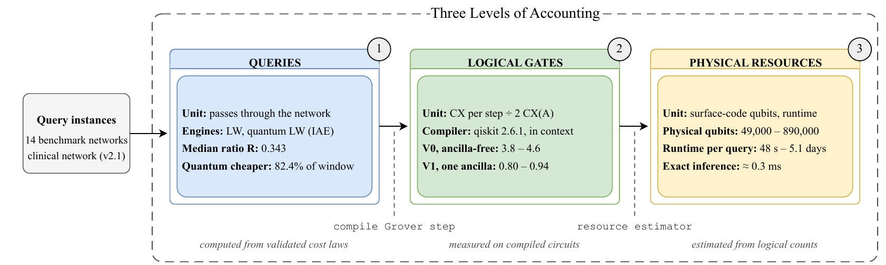
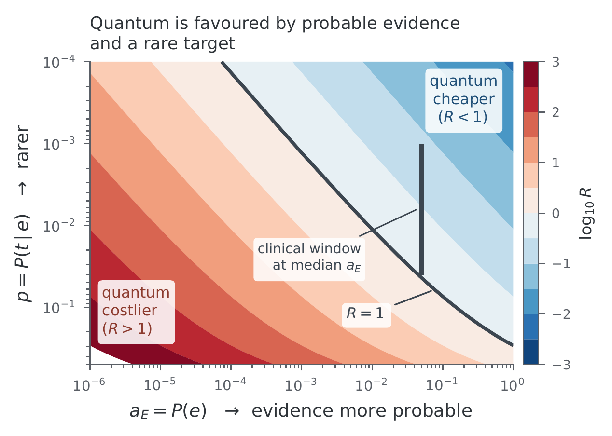
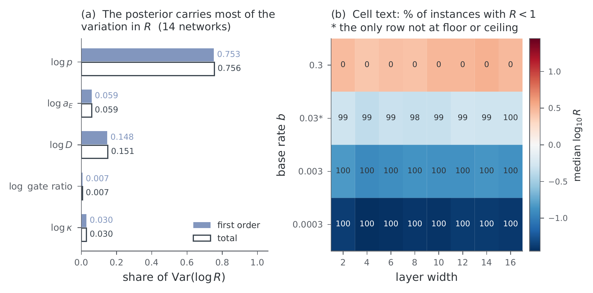
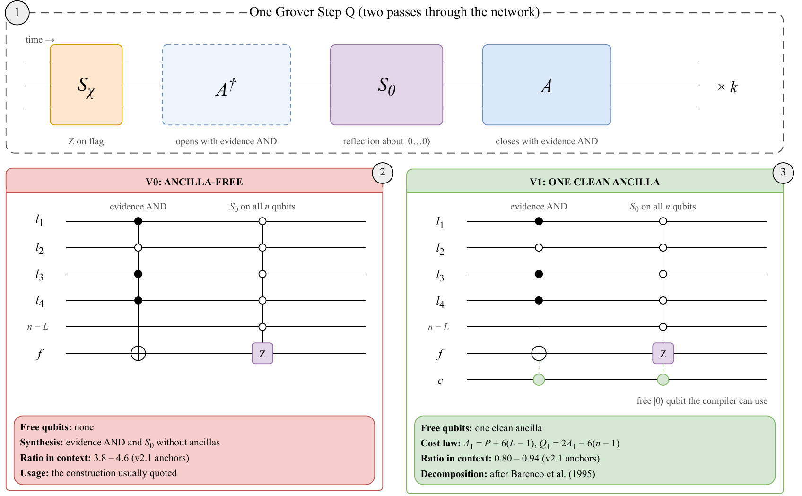
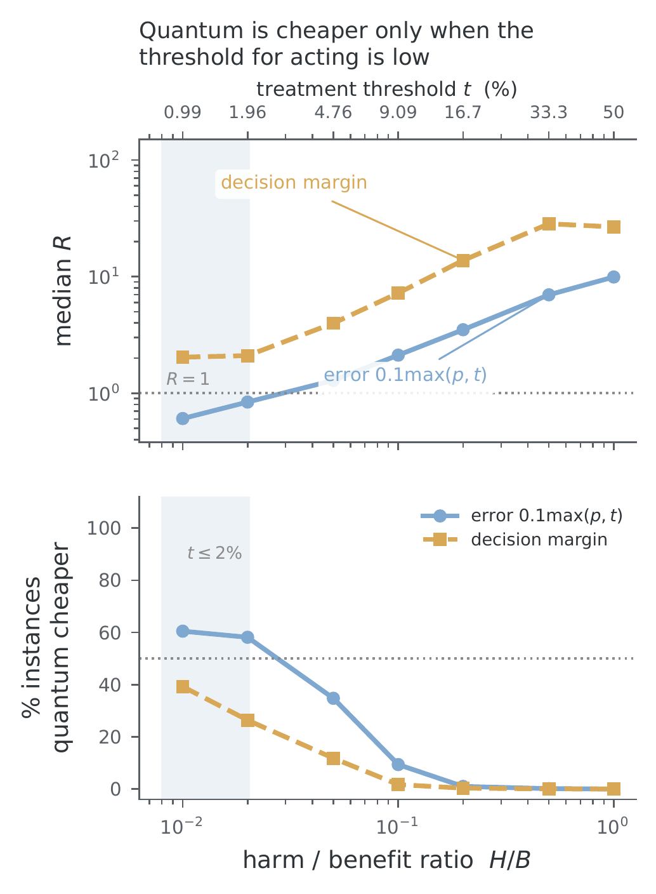

# Accounting for Quantum Advantage in Bayesian Network Inference

Code, figures and paper for a study of **when quantum amplitude estimation is cheaper than classical likelihood weighting** for conditional inference on discrete Bayesian networks, and of what that advantage costs once it is compiled into gates and mapped to fault-tolerant hardware.

📄 **Paper:** *Accounting for Quantum Advantage in Bayesian Network Inference* (manuscript). Section references below follow the paper.

> Research code. Not clinically validated and not for clinical use.

---

## In one paragraph

Earlier work showed that quantum rejection sampling needs about `1/√P(e)` network passes where classical rejection sampling needs `1/P(e)`. A practitioner, though, would run **likelihood weighting**, which never discards a sample. We compare quantum likelihood weighting (iterative amplitude estimation on a weight-absorbed state) against classical likelihood weighting. Both run on the same pruned network and must meet the same target: 10% relative error on the posterior with 90% success. We count the cost at three levels: queries, compiled logical gates, and estimated physical resources. Both the closed-form ratio law and the experiments say the advantage depends on the **target posterior and the evidence amplitude**, not on how rare the evidence is or how large the network is. The advantage survives compilation only if the Grover step has a clean ancilla. It disappears in wall-clock time.

## Headline results


*The same query instances are costed three times: in passes through the network, in compiled gates, and in fault-tolerant physical resources.*

| Level                 | What is counted                                                                         | Result                                                                                                                                            |
| --------------------- | --------------------------------------------------------------------------------------- | ------------------------------------------------------------------------------------------------------------------------------------------------- |
| 1. Queries            | passes through the network                                                              | Median cost ratio **R = 0.343** in the clinical window (1% action threshold). Quantum is cheaper in **82.4%** of instances.           |
| 2. Logical gates      | CX per Grover step ÷ 2 CX of the state preparation (qiskit 2.6.1, compiled in context) | Ancilla-free construction **V0: 3.8 to 4.6**. One clean ancilla **V1: 0.80 to 0.94**.                                                 |
| 3. Physical resources | Azure Quantum resource estimator, 6 hardware profiles, surface and Floquet codes        | **49,000 to 890,000 physical qubits** and **48 s to 5.1 days** per median query. Classical exact inference takes **≈ 0.3 ms**. |

<p align="center"></p>

*The ratio law over the plane of evidence amplitude a_E and posterior p. Quantum likelihood weighting is cheaper (R < 1) only when the evidence is probable and the target is rare. The clinical window lies largely inside that region.*

Further findings:

- **Rarity of the evidence does not drive the classical cost.** Across 292 stratified clinical queries, log likelihood-weighting cost follows the log target odds (R² = 0.86, slope 1.04). Evidence rarity adds 0.004 to R².
- **Network structure does not explain R within a network.** The within-network Spearman correlation between exact-inference cost and R is −0.017 (90% CI −0.071 to 0.043), equivalent to zero at a margin of |ρ| = 0.2. log p carries 0.753 of the variance of log R (first-order Sobol index).
- **The gate-cost law is exact.** It holds on all 224 standalone grid circuits, and V1 beats V0 in all 35 compiler combinations.
- **The estimator constant κ does not transfer between query populations.** A κ map calibrated on benchmarks has a slope of 1.10 there and 0.449 (95% CI 0.085 to 0.898) on clinical queries.


*(a) The target posterior carries most of the variance of log R across the 14 benchmark networks. (b) In a controlled factorial, the share of instances with R < 1 changes with the base rate of the target (rows) and not with network width (columns).*


*One Grover step, compiled two ways. Without a spare qubit (V0) it costs 3.8 to 4.6 times two state preparations. With one clean ancilla (V1) it costs 0.80 to 0.94 times.*

<p align="center"></p>

*Clinical decision thresholds. Quantum is cheaper only when the threshold for acting is about 2% or lower. Under the decision-margin metric it is costlier at every threshold.*

The central claims were checked by a statistical audit whose plan was frozen before the run. Run it with `python scripts/audit.py`.

---

## Repository layout

```
.
├── src/qddx/              Python package: Bayesian networks, quantum circuits, knowledge base, agent, evaluation, CLI
├── scripts/               One script per study: cost laws, benchmarks, gate counts, κ calibration, FT estimates, audit
├── configs/               Pipeline settings (qddx.yaml), the frozen vocabularies (vocab_v2.1.json = clinical network)
│                          and the parent sets of the clinical network (clinical_structure_v2.1.json, no probabilities)
├── tests/                 Unit tests and a synthetic end-to-end test (no patient data, fake LLM)
└── figures/
    ├── diagrams/          draw.io sources (.drawio) and exported PDFs of the paper diagrams
    ├── plots/             Result plots used in the paper
    ├── circuits/          Circuit drawings and qc_figs.py, the qiskit script that draws them
    └── readme/            PNG copies of the key figures shown in this README
```

---

## Data: what you need, and where to get it

**No dataset is included in this repository.** The clinical data are credentialed, and their licence forbids redistribution. Download them yourself from the sources below.

| Dataset                                                                                                                                                   | Used for                                                                    | Access                                                                                                                                                  | Where to put it                                  |
| --------------------------------------------------------------------------------------------------------------------------------------------------------- | --------------------------------------------------------------------------- | ------------------------------------------------------------------------------------------------------------------------------------------------------- | ------------------------------------------------ |
| **MIMIC-IV v3.1** (`hosp` module)                                                                                                                 | learning the clinical network (46 binary nodes), clinical query instances   | Credentialed: PhysioNet account, CITI "Data or Specimens Only Research" training, signed data use agreement. https://physionet.org/content/mimiciv/3.1/ | `data/mimic-iv-3.1/hosp/*.csv(.gz)`            |
| **MIMIC-IV-Note v2.2** (`discharge.csv.gz`)                                                                                                       | held-out evaluation of the agentic reader on discharge summaries            | Credentialed, same steps. https://physionet.org/content/mimic-iv-note/2.2/                                                                              | `data/mimic-iv-note-2.2/note/discharge.csv.gz` |
| **bnlearn benchmark networks** (asia, cancer, earthquake, survey, sachs, child, insurance, water, alarm, hailfinder, hepar2, win95pts, andes, pigs) | the 14-network benchmark corpus                                             | Public. Loaded automatically through `pgmpy.utils.get_example_model`. Source: https://www.bnlearn.com/bnrepository/                                   | nothing to download                              |
| **ICD-9-CM to ICD-10-CM GEMs** (`icd9toicd10cmgem.csv`)                                                                                           | only for `scripts/bands.py cats` (ICD-10 categories for ICD-9 admissions) | Public, NBER/CMS. https://www.nber.org/research/data/icd-9-cm-and-icd-10-cm-and-icd-10-pcs-crosswalk-or-general-equivalence-mappings                    | `artifacts/bands/icd9toicd10cmgem.csv`         |

The paths are set in [`configs/qddx.yaml`](configs/qddx.yaml) under `paths:`. You can change them there, or override them per run, for example `--set paths.mimic_root=/my/mimic`.

> **Development notes file.** Agent development and ablations also used a 200-note development file (`paths.notes_csv`). That file is not distributed. The held-out test removes every patient in that file, so without it, set `exclude_dev_patients: false` under `mimic_notes:` in `configs/qddx.yaml`. The stages `notes`, `engines` and `privacy` need that file and can be skipped.

**What runs without any credentialed data:** the tests, the synthetic dry run, and the benchmark studies: the corpus, the factorial, multi-state encoding, measurement-based uncomputation and κ calibration on benchmarks. Clinical numbers need MIMIC-IV. A few gate-count and resource scripts also read aggregate outputs of the clinical run (see *Reproducing the paper*).

Everything the code writes (`artifacts/`, `reports/`) is git-ignored and should stay on your machine.

---

## Installation

Python ≥ 3.11.

```bash
git clone <this repository>
cd <this repository>
python -m venv .venv && source .venv/bin/activate        # Windows: .venv\Scripts\activate
pip install -e ".[test]"                                  # core package + pytest, xgboost
pip install -e ".[paper]"                                 # cost-paper scripts: pgmpy, pytket, qsharp, statsmodels, ...
pip install -e ".[extra-models]"                          # optional: torch (born.py, vqc.py)
```

**Compiler versions matter for gate counts.** The paper's counts use **qiskit 2.6.1**. qiskit 2.2.3 cannot borrow busy qubits inside a circuit, so its Grover steps cost more. The paper reports this as a sensitivity check. To reproduce both, use two environments:

```bash
python -m venv .venv-qk261 && .venv-qk261/bin/pip install qiskit==2.6.1 qiskit-algorithms==0.4.0 pytket==2.18.5 pytket-qiskit==0.79.0 pgmpy==1.1.2 numpy scipy pandas pyarrow
python -m venv .venv-qk223 && .venv-qk223/bin/pip install qiskit==2.2.3 qiskit-algorithms==0.4.0 numpy scipy pandas pyarrow
```

`scripts/run_corrections.sh` (or `.ps1` on Windows) creates both environments and runs the in-context gate-count steps in order.

---

## Quick start (no data needed)

```bash
python -m pytest                          # unit tests + synthetic end-to-end run (fake LLM, synthetic MIMIC-shaped tables)
qddx synth --out artifacts/synthetic      # build a synthetic MIMIC-shaped dataset, then run the command it prints
python scripts/benchmarks.py instances    # 1,000 query instances per benchmark network (needs .[paper])
```

The instance file is deterministic (seed 2026). Its hash in `artifacts/quantum_paper/benchmark_instances.sha256` should equal the pre-registered hash `789940286ea5836d3accb60a106d9a4c0cc1b0c63d26a88ab62020ab9ac0d564`. A fresh rebuild with pgmpy 1.1.2 reproduces it exactly.

---

## Reproducing the paper

All scripts run from the repository root. Each writes its outputs to `artifacts/<study>/` and prints a short summary. Each test and its pass rule were fixed in a written plan before the run.

| Paper section                 | What it shows                                                        | Command(s)                                                                                                                                                   | Data                    |
| ----------------------------- | -------------------------------------------------------------------- | ------------------------------------------------------------------------------------------------------------------------------------------------------------ | ----------------------- |
| III Problem statement, App. A | cost laws for LW and quantum LW, ratio law, decision ratio           | derivations in the paper; numeric checks `python scripts/lw_check.py`, `python scripts/ae_check.py sweep`                                                | MIMIC (lw_check) / none |
| IV-A, IV-B, App. F            | benchmark corpus, 13,477 usable instances, pruning                   | `python scripts/benchmarks.py instances` → `costs NETWORK` (each of the 14) → `w4`                                                                   | public                  |
| V-A, Fig. 4                   | what governs R (Sobol shares, within-network correlation)            | `python scripts/benchmarks.py w4`, then `python scripts/audit.py --only quantum`                                                                         | public                  |
| V-A                           | width × base-rate factorial                                         | `python scripts/benchmarks.py w5f` → `w5f-analyse`                                                                                                      | synthetic               |
| V-A                           | LW cost follows the target odds, not rarity (292 queries)            | `python scripts/quantum_study.py lwmech`                                                                                                                   | MIMIC                   |
| V-B, Fig. 5                   | clinical window, R = 0.343, 82.4% cheaper                            | `python scripts/bands.py w6 BAND` for `common` and `uncommon`, then `w6-summary`. The earlier steps it relies on are listed in the script docstring. | MIMIC                   |
| V-B, Fig. 6                   | Pauker–Kassirer threshold sweep                                     | `python scripts/round3_w6.py pk`                                                                                                                           | MIMIC                   |
| V-C, App. D                   | gate-cost law, V0/V1 constructions, 224-circuit grid                 | `python scripts/cost_model.py sweep` → `fit`; `python scripts/cost_model_ms.py sweep` → `fit`; `python scripts/oracle_v2.py test` → `count`   | public / structure only |
| V-C, App. D                   | in-context compilation, compiler sweep (qiskit 2.2.3, 2.6.1, pytket) | `bash scripts/run_corrections.sh`                                                                                                                          | public / structure only |
| App. B, App. C                | multi-state register encoding and its four validation gates          | `python scripts/msbn.py validate`, `python scripts/msbn.py variants`                                                                                     | public                  |
| App. D                        | measurement-based uncomputation, cost-law exceptions                 | `python scripts/round3_q.py mbu`, `python scripts/round3_q.py exceptions`, `python scripts/round3_q6.py`                                               | synthetic               |
| V-D, App. E, Fig. 7           | estimator constant κ: IAE vs MLAE, κ map, clinical calibration     | `python scripts/w8.py kappa`, `python scripts/round3_q.py kappa-map`, `python scripts/w8.py kappa-clinical`, `python scripts/round3_w6.py kappa`     | public / MIMIC          |
| V-E, App. H, Table III        | fault-tolerant resource estimates                                    | `python scripts/w8.py circuits`, `python scripts/w8.py ft`                                                                                               | structure only          |
| App. G                        | statistical audit of the central claims                              | `python scripts/audit.py` (`--quick` for a 15-minute check)                                                                                              | public + MIMIC          |
| Figures                       | circuit drawings                                                     | `python figures/circuits/qc_figs.py`                                                                                                                       | none                    |

"Structure only" means the script needs only the parent sets of the clinical network, never its probabilities. Those parent sets are shipped in [`configs/clinical_structure_v2.1.json`](configs/clinical_structure_v2.1.json): 46 nodes and 156 edges. Copy the file to where the scripts expect it:

```bash
mkdir -p artifacts/v2.1/kb && cp configs/clinical_structure_v2.1.json artifacts/v2.1/kb/structure_only.json
```

Some of these scripts also read aggregate outputs of the clinical run. For example, `w8.py ft` reads `artifacts/v2.1/results/resources.json`, written by `qddx resources`. Without MIMIC, the scripts still run on the benchmark networks and the synthetic grids.

---

## The clinical network and the agentic reader (Q-DDx)

The clinical queries in the paper come from a network learned from MIMIC-IV. The package `qddx` builds it and wraps it in a neuro-symbolic diagnosis pipeline.

- **Knowledge base.** Adult admissions in MIMIC-IV v3.1 are split 80/20 by patient (seed 2026). Items are selected on training patients only (`qddx discover`, then `qddx freeze-vocab`). The frozen v2.1 vocabulary has 40 findings (coded history, first-24 h medications, first admission labs, age ≥ 65) and 6 diagnoses (heart failure, atrial fibrillation, urinary tract infection, pneumonia, acute kidney injury, anaemia). That gives 46 binary nodes, at most 4 parents per node, and 156 learned edges. Lab limits are the median of MIMIC's own reference ranges. No external clinical rules are used.
- **Quantum-symbolic engine.** Each proposition is a qubit. Conditional probability tables are loaded with multiplexed RY rotations, and evidence is a multi-controlled X onto a flag qubit. P(diagnosis | findings) = P(d, E) / P(E), with each term estimated by iterative amplitude estimation. Exact inference, rejection sampling and likelihood weighting run on the same network for comparison.
- **Agentic neural layer.** A **local** LLM served by [Ollama](https://ollama.com) reads the admission part of a de-identified note and grounds it into propositions. Every finding must quote the note verbatim, and anything without a quote is discarded. The engine then picks the unknown finding with the highest expected information gain, and the agent investigates it with a `search_note` tool, for up to 3 rounds.
- **Output.** An f-string template filled from computed numbers. No language model writes the explanation.

The run has two steps. The first freezes the random 1,500-note sample that every agent reads. The second runs everything with the v2.1 network:

```bash
# Step 1: v1 run (16 hand-picked items). Builds the knowledge base and freezes artifacts/mimic_notes/agent_sample.txt.
#         Add --set agent.backend=baseline to skip the LLM in this step.
qddx build-kb
qddx mimic-notes

# Step 2: every stage with the frozen v2.1 vocabulary, written to artifacts/v2.1/ and reports/v2.1/,
#         on the same notes and the same agent sample, followed by the v1-vs-v2.1 comparison.
qddx test --vocab configs/vocab_v2.1.json
```

Set `mimic_notes.exclude_dev_patients: false` first if you do not have the development file (see Data above). In that case the eligible note set can differ slightly from the paper (62,867 notes), because its 82 patients are not removed. Every stage caches its result in `artifacts/.../results/<stage>.json`. Add `--force` to recompute.

All CLI commands: `build-kb`, `eval-kb`, `notes`, `engines`, `advantage`, `privacy`, `mimic-notes`, `sensitivity`, `followup-curve`, `temporal`, `resources`, `agent-models`, `discover`, `freeze-vocab`, `test`, `run`, `report`, `explain`, `synth`. You can override any setting with `--set key=value`, for example `--set agent.backend=baseline` to run without any LLM.

---

## Using a different LLM

The agent works with any model your local Ollama server can run. The default is `gpt-oss:20b`.

To compare models on the same frozen 1,500-note sample, pull them and list them under `experiments.agent_models` in `configs/qddx.yaml`, or pass them on the command line:

```bash
ollama pull qwen3:14b
ollama pull medgemma:27b
qddx test --vocab configs/vocab_v2.1.json --set "experiments.agent_models=[qwen3:14b, medgemma:27b]"
```

Models that are not installed are skipped and reported. The results go to `reports/v2.1/experiments.md` (section "Other LLMs"), paired against the reference model and the keyword extractor.

To make another model the **primary** agent, set both `agent.model` and `experiments.reference_model`. For example, add `--set agent.model=qwen3:14b --set experiments.reference_model=qwen3:14b` and use a fresh `paths.artifacts` folder.

A test call checks whether each model supports native tool calling and a `think` setting. Models without tool calling use a JSON text protocol for the follow-up searches instead. Agent outputs are cached per model, so a rerun does not call the LLM again. **Only local models are allowed.** Model names with a `cloud` tag are refused, because notes must never leave the machine. Do not send MIMIC notes to a hosted API, since the PhysioNet data use agreement forbids it.

### Models we tested

Every model read the same frozen sample of **1,500 held-out MIMIC-IV-Note discharge summaries** (1,424 patients). Scores are macro AUROC over the six diagnoses. Running the panel writes the 95% patient-bootstrap intervals and paired differences to `reports/v2.1/experiments.md`. *Grounding* is the model's single reading of the note. *+ follow-ups* adds up to three engine-chosen searches.

| Model (Ollama tag)             | Type                       | Search protocol | AUROC, note truth: grounding → + follow-ups | AUROC, ICD truth: grounding → + follow-ups | Top-3 hit (note truth, + follow-ups) |
| ------------------------------ | -------------------------- | --------------- | -------------------------------------------- | ------------------------------------------- | ------------------------------------ |
| keyword extractor (no LLM)     | rule-based baseline        | none            | 0.752                                        | 0.757                                       | 0.781                                |
| `gpt-oss:20b` (reference)    | general                    | native tools    | 0.749 → **0.755**                     | 0.752 → **0.755**                    | 0.781                                |
| `mistral-small3.2:24b`       | general                    | native tools    | 0.742 → 0.746                               | 0.751 → 0.753                              | 0.778                                |
| `qwen3:14b`                  | general                    | native tools    | 0.736 → 0.741                               | 0.743 → 0.749                              | 0.769                                |
| `llama3.1:8b`                | general                    | native tools    | 0.663 → 0.711                               | 0.679 → 0.725                              | 0.769                                |
| `medgemma:27b`               | medical (Google MedGemma)  | JSON text       | 0.683 → 0.708                               | 0.688 → 0.709                              | 0.730                                |
| `gemma3:27b`                 | general (base of MedGemma) | JSON text       | 0.678 → 0.693                               | 0.670 → 0.691                              | 0.723                                |
| `thewindmom/llama3-med42-8b` | medical (M42 Med42 8B)     | JSON text       | 0.625 → 0.660                               | 0.646 → 0.671                              | 0.709                                |
| `llama3:latest` (8B)         | general (base of Med42)    | JSON text       | 0.614 → 0.615                               | 0.627 → 0.627                              | 0.665                                |

What the panel shows:

- **The engine's follow-up questions help every model.** The gain is largest for weaker readers, for example +0.048 AUROC for `llama3.1:8b` against note truth. The engine's chosen question had 3.5 times the expected information gain of a random eligible question (0.044 vs 0.013 nats) and beat the random mean in 99.6% of cases.
- **No LLM beat the keyword extractor at grounding.** With follow-ups, `gpt-oss:20b` reaches 0.755 against 0.752 for the extractor (note truth). `qwen3:14b` and `mistral-small3.2:24b` are slightly below the extractor at grounding, with intervals that exclude zero.
- **Medical fine-tuning showed no clear AUROC gain against note truth.** MedGemma vs Gemma 3: +0.005, CI includes 0. Med42 vs Llama 3: +0.011, CI includes 0. Against ICD truth, Med42 gains +0.020 (CI excludes 0) and MedGemma +0.018 (CI includes 0). MedGemma was much better calibrated than Gemma 3 (Brier −0.040 against note truth).

**Supported but not evaluated:** the config also lists an opt-in extended panel (`phi4:latest`, `granite4.1:30b`, `qwen2.5:32b`, `deepseek-r1:14b`). Enable it with `--set experiments.include_extended=true`. Any other Ollama model can be added the same way.

---

## Privacy and data use

- No patient-level data, note text or identifiers are in this repository.
- Run the pipeline only on a machine covered by your PhysioNet data use agreement, and keep `data/`, `artifacts/` and `reports/` out of version control. The `.gitignore` already does this.
- The agent only talks to a local Ollama server (`agent.url`, default `http://127.0.0.1:11434`).

Please also take a look at MIMIC-IV, MIMIC-IV-Note and PhysioNet as their pages request, along with the bnlearn repository.
